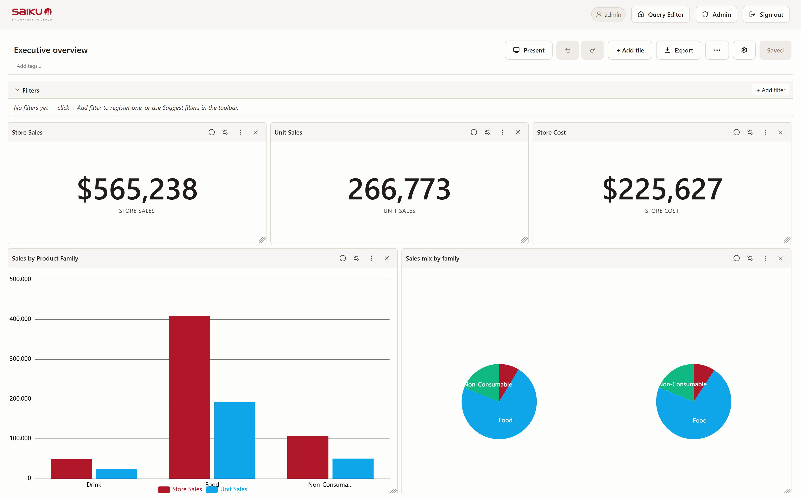

<a href="#readme"></a>

<h1 align="center"><a href="https://saiku.bi">Saiku Analytics</a></h1>

<p align="center">
  Open-source Semantic Layer analytics for cubes — drag-and-drop in the
  browser, SQL through Mondrian + Calcite, and a typed REST surface so AI
  agents can query without ever seeing MDX.
</p>

<p align="center">
  <a href="https://saiku.bi"><b>saiku.bi</b></a> ·
  <a href="https://demo.saiku.bi"><b>Live demo</b></a> ·
  <a href="https://github.com/spiculedata/saiku/issues"><b>Issues</b></a> ·
  <a href="https://github.com/spiculedata/saiku/discussions"><b>Discussions</b></a>
</p>

<p align="center">
  <a href="https://github.com/spiculedata/saiku/releases"></a>
  <a href="LICENSE"></a>
  <a href="https://github.com/spiculedata/saiku/pkgs/container/saiku"></a>
  <a href="https://join.slack.com/t/saikucloud/shared_invite/zt-3yor7kgiv-YUPhqK0pvd4WljctIQVOTA"></a>
</p>

***

<picture>
  <source media="(prefers-color-scheme: dark)" srcset="docs/images/dashboard-dark.png">
  
</picture>

## Try it in 30 seconds

```sh
docker run -d -p 8080:8080 --name saiku -e SAIKU_DEMO=true ghcr.io/spiculedata/saiku
```

Then open <http://localhost:8080/ui/> and log in with `admin` / `admin`. Demo
mode ships a self-contained H2 + FoodMart cube — drag fields onto rows, columns,
or filters and the SPA writes MDX for you.

> **For a real deployment**, drop `SAIKU_DEMO=true` and set an admin password:
> `-e SAIKU_ADMIN_PASSWORD='a-strong-password'` (or
> `-e SAIKU_ADMIN_PASSWORD_FILE=/run/secrets/saiku-admin-password`). Saiku
> **refuses to start** on the default `admin`/`admin` once it's network-reachable,
> so one of those two is required — and the password must itself clear the policy
> (≥ 12 characters, not a well-known weak password), so `SAIKU_ADMIN_PASSWORD=admin`
> is refused too.

> **Demo fixtures follow demo mode** (saiku#1953). A boot without `SAIKU_DEMO=true`
> stages **no** demo content: no FoodMart/Bank/TPC-DS/Flights schemas, no H2
> fixtures, no datasource descriptors — a fresh home comes up with an empty
> datasource list. Set `SAIKU_SEED=true` to install the fixtures on a
> non-demo boot, or `SAIKU_DEMO=true SAIKU_SEED=false` for the demo login against
> your own cubes. Seeding is seed-if-absent, so an existing `saiku-home` is never
> rewritten or emptied.

> **The container runs as a non-root user** (uid/gid `10001:10001`). A *fresh*
> named/anonymous volume works out of the box. Any **pre-existing** `saiku-home`
> from an older root container — bind mount or named volume — must be re-owned
> once: `sudo chown -R 10001:10001 <host-dir>`, or for a named volume
> `docker run --rm -v saiku-home:/app/saiku-home --user 0 --entrypoint chown
> ghcr.io/spiculedata/saiku:latest -R 10001:10001 /app/saiku-home`. The
> container fails closed with a `FATAL:` message (naming the fix) rather than
> silently rotating its encryption key. On Kubernetes set
> `securityContext: { runAsUser: 10001, fsGroup: 10001 }`. See the
> [CHANGELOG](CHANGELOG.md) upgrade note for details.

A hosted instance is always live at <https://demo.saiku.bi> (auto-reset
nightly).

## What is Saiku

Saiku started in 2010 as an open-source OLAP browser for Mondrian. In 2026
it was rebuilt as a modern Semantic Layer on top of:

- **Mondrian 4.8.1.x (Spicule fork)** — with a Calcite-based SQL planner
  alongside the legacy `SqlQuery` builder. Calcite is the default; force
  legacy with `-Dmondrian.backend=legacy`. The Calcite planner reaches
  modern engines too — see [`examples/lakehouse-demo`](examples/lakehouse-demo)
  for a Saiku → Mondrian → Calcite → Trino → Iceberg walkthrough.
- **Apache Arrow** wire format for cellsets, so the browser and any
  programmatic consumer share a zero-copy result envelope.
- **Jetty 12 EE10 + Jersey 3.1 + Spring 6 + Spring Security 6.5** in a
  single-JAR Picocli launcher.
- **SvelteKit 5 + Vite** for the SPA (built independently from the
  `saiku-ui/` directory in this repository, served from inside the same
  JAR at `/ui/`).

## AI Query API + MCP

Saiku 4.x exposes a typed REST surface — `/rest/saiku/api/ai/*` — designed
for LLM agents. Hierarchies, levels, measures and synonyms are discoverable
via `/ai/cubes` and `/ai/schema`, and a single `POST /ai/query` translates
a JSON description of a question into validated MDX, runs it, and returns
typed `{value, formatted, unit}` cells. Every validation failure carries
a `{status, field, available}` envelope so an agent can self-correct
without scraping logs.

The same self-describing, self-correcting contract has a **SQL-side twin at
`/rest/saiku/api/ai/ossie/*`** for datasets modelled with the Ossie semantic
layer — same list → schema → query shape, same `VALIDATION_ERROR` envelope,
plus `POST /ai/ossie/ask` for a plain-language question. Anomaly and forecast
endpoints (`/ai/anomaly`, `/ai/forecast`) share the same typed envelope.

The container also bundles **`saiku-mcp`**, a stdio
[Model Context Protocol](https://modelcontextprotocol.io) wrapper so Claude
Desktop / Cursor / Cline can wire to a running Saiku with one line of
config:

```json
{
  "command": "docker",
  "args":    ["exec", "-i", "saiku", "saiku-mcp"]
}
```

See [`docs/AI-QUERY-API.md`](docs/AI-QUERY-API.md) and
[`docs/schema-annotations.md`](docs/schema-annotations.md) for the typed
contract and the `saiku.semantic.*` annotation namespace cubes use to
describe themselves to agents.

## Semantic model diff

Reviewing a schema change before it lands:

```bash
# What does this edit break?
saiku model diff --from-git origin/development --from-git HEAD \
  --before saiku-launcher/src/main/resources/seed/FoodMart4.xml \
  --after   saiku-launcher/src/main/resources/seed/FoodMart4.xml \
  --repository ./saiku-home/repository/data
```

Diffs two models (Mondrian XML or Apache Ossie YAML), detects renames as renames,
and lists every saved query, dashboard and app still pointing at a member the change
removes — as Markdown, JSON, or `POST /rest/saiku/api/admin/model/diff`. On a pull
request that touches a model, the `model-diff` workflow posts the same report as a
sticky comment. See [`docs/MODEL-DIFF.md`](docs/MODEL-DIFF.md).

## Semantic model generation

Point Saiku at a warehouse and it will build a starting Ossie semantic
model — cubes, dimensions, measures, joins — plus a rationale document
explaining every decision. See
[`docs/OSSIE-MODEL-GENERATION.md`](docs/OSSIE-MODEL-GENERATION.md).

## Agent Skills & Spaces

Admins can extend the AI surface without code:

- **Skills** (`saiku-home/skills/*.md`) — markdown workflows with YAML
  frontmatter, discoverable from `/ai/ask`. Invoke one explicitly by prefixing
  an ask with `/<skill-name>`, or ask naturally and let the LLM route via the
  skill catalogue.
- **Spaces** (`saiku-home/agent-spaces/*.json`) — named personas that scope an
  ask to a system prompt, a cube allowlist and a skill allowlist.
  `POST /ai/spaces/{id}/ask` enforces the persona server-side, so a cube outside
  the allowlist is a 403 the user can't override.

See [`docs/SKILLS-SPEC.md`](docs/SKILLS-SPEC.md) and
[`docs/AGENT-SPACES-SPEC.md`](docs/AGENT-SPACES-SPEC.md).

## Dashboards

Build shareable dashboards of chart / table / KPI / text / image tiles over your
cubes — with cross-tile filters, click- and brush-cross-filtering,
drill-down/through, conditional formatting, combo charts, anomaly/forecast
overlays, auto-refresh, PDF/PNG export and read-only share links. See the
[`docs/dashboards-user-guide.md`](docs/dashboards-user-guide.md) for the full
walkthrough, and [`saiku-ui/src/embed/README.md`](saiku-ui/src/embed/README.md)
to embed a dashboard in your own app via the `<saiku-embed>` web component.

## User provisioning (SCIM 2.0)

Saiku speaks the SCIM 2.0 core profile, so Okta, Microsoft Entra ID or
OneLogin can own the user lifecycle: an admin mints one bearer token per
connector, and create / update / deactivate / group-assignment all flow into
the Saiku user directory without anyone touching the admin console. SCIM
handles lifecycle; OIDC/SAML handles authentication — a provisioned account has
no usable local password. See
[`docs/SCIM-PROVISIONING.md`](docs/SCIM-PROVISIONING.md) for the connector
walkthrough, the attribute mapping and its limits.

## Google Sheets add-on

A first-party Sheets add-on (`integrations/google-sheets/`, spiculedata/saiku#1436)
queries the semantic layer from a spreadsheet sidebar — cube picker, measure
and dimension shelves, *Insert as table*, and a *Refresh* that rewrites the
same block in place so your formatting survives. It talks to the same typed
`/saiku/api/ai/*` surface as the MCP server and the Excel add-in. See
[`docs/sheets.md`](docs/sheets.md).

## Observability

Saiku ships **opt-in OpenTelemetry instrumentation** via the OTel Java
agent — zero code changes, zero overhead when off. Setting
`OTEL_EXPORTER_OTLP_ENDPOINT` activates auto-instrumentation for Jetty,
Jersey, JDBC (every Mondrian-emitted SQL becomes a child span),
outbound HTTP, JVM metrics, and DBCP2 connection pool metrics. Trace
context is injected into the Saiku log pattern automatically.

```sh
docker run -d -p 8080:8080 \
  -e OTEL_EXPORTER_OTLP_ENDPOINT=http://otel-collector:4318 \
  -e OTEL_SERVICE_NAME=saiku-prod \
  ghcr.io/spiculedata/saiku:latest
```

Without the endpoint env var the agent is never loaded. See
[`docs/observability.md`](docs/observability.md) for the full env-var
reference, sampling guidance, and what's not yet covered (Tier 2
custom spans for `ThinQueryService` etc.).

## Operator hardening knobs

Two guardrails an operator is expected to tune, both documented in
[`docs/operator-hardening.md`](docs/operator-hardening.md):

- **SMTP relay host** — the admin mail wizard's host is put through the same
  resolve-and-range SSRF gate alert webhooks use, plus an SMTP port allowlist
  (`saiku.mail.smtp.*`). Prefer an ops-managed relay via `SAIKU_MAIL_SMTP_HOST`,
  which makes the wizard read-only.
- **AI ask cost budget** — per-principal and per-instance daily ceilings
  charged from the token usage the provider actually reports, plus a cap on
  concurrent chained asks (`saiku.ai.budget.*`).

## Quality

Quality signals — per-module test-count and line-coverage floors, UI type
checks, UI tests — are declared as files (`.github/test-floors.json`,
`.coverage-thresholds.json`) and **gated on every PR** by the `ci` workflow.
A separate weekly run, `.github/workflows/quality-report.yml`, renders the same
signals as one Markdown **quality dashboard** in its job summary: where each
module stands, and by how much headroom. That run is read-only and is not a
gate — the gates stay in CI. See [`docs/quality.md`](docs/quality.md). For how
CI, the merge queue, images, previews and the demo deployment fit together, see
[`docs/ci-overview.md`](docs/ci-overview.md).

## Build from source

JDK 21 + Maven 3.9+ required.

**Set up GitHub Packages auth first, or the build fails before it compiles.** Saiku's Mondrian fork, olap4j,
saiku-query and Ossie artifacts are published to GitHub Packages, which requires an authenticated token **even
though the packages are public**. Without it you get a bare `401 Unauthorized` on `pentaho:mondrian` that never
mentions tokens:

1. Create a **classic** personal access token with only the `read:packages` scope
   ([Tokens (classic)](https://github.com/settings/tokens/new)). It must be classic — [GitHub's Maven registry
   does not accept fine-grained tokens](https://docs.github.com/en/packages/working-with-a-github-packages-registry/working-with-the-apache-maven-registry),
   and the UI defaults to fine-grained. Our packages are public, so no `repo` scope or org membership is needed.
2. Add five `<server>` entries to `~/.m2/settings.xml` — `github-mondrian-saiku`, `github-olap4j`,
   `github-olap4j-xmlaserver`, `github-saiku-query`, `github-ossie`. Copy the block from
   [`.github/workflows/ci.yml`](.github/workflows/ci.yml); one token covers all five.

Still getting a 401? A fine-grained token and a classic token missing `read:packages` produce an identical error,
so check what the token actually has before minting another —
`curl -sI -H "Authorization: token $PAT" https://api.github.com/user | grep -i x-oauth-scopes`. A classic token's
scopes are editable in place, and the value doesn't change, so `settings.xml` needs no edit.

```sh
# Compile, unit tests, Spotless format check (CI gate):
mvn verify

# Build the runnable fat-JAR:
mvn -pl saiku-launcher -am -Dmaven.test.skip=true package

# Run:
java -jar saiku-launcher/target/saiku-*.jar serve --port 8080 --home ./saiku-home
```

Whole-API integration tests (boots Jetty + the launcher's WAR in-process
against the seeded FoodMart H2 datasource):

```sh
mvn verify -P integration
```

See [`CLAUDE.md`](CLAUDE.md) for the full layout, the dependency catalog
(`saiku-bom`), and the GitHub Packages auth gotcha for local builds.

## Verifying release artifacts

The fat JAR, dist zip, SBOM, container image and npm packages carry
keyless [Sigstore](https://www.sigstore.dev/)-signed SLSA build provenance,
and each release ships a `SHA256SUMS` file. See
[Verifying release artifacts](docs/releasing.md#verifying-release-artifacts)
for the commands per artifact type (`gh attestation verify`,
`cosign verify-attestation`, `sha256sum -c`, `npm audit signatures`).

## Repository layout

```
saiku-bom/             # central dependency-version catalogue
saiku-core/
  saiku-olap-util/     # olap4j helpers
  saiku-service/       # Semantic Layer service, AI Query, schema gen, async, cache
  saiku-semantic/      # YAML semantic layer
  saiku-web/           # JAX-RS REST resources
saiku-webapp/          # Servlet webapp (Spring XML wiring)
saiku-launcher/        # Picocli CLI + embedded Jetty serving the WAR
saiku-mcp/             # stdio JSON-RPC MCP wrapper
saiku-ui/              # SvelteKit SPA (independent versioning)
```

The SvelteKit SPA lives in `saiku-ui/` and is built independently; the
launcher serves the static `dist/` under `/ui/`.

## Getting help

- **Bugs and feature requests**:
  [open an issue](https://github.com/spiculedata/saiku/issues/new/choose).
- **Questions, ideas, walkthroughs**:
  [GitHub Discussions](https://github.com/spiculedata/saiku/discussions).
- **Chat**: [Saiku Cloud Slack](https://join.slack.com/t/saikucloud/shared_invite/zt-3yor7kgiv-YUPhqK0pvd4WljctIQVOTA).
- **Stack Overflow tag**:
  [`saiku`](https://stackoverflow.com/questions/tagged/saiku).
- **Commercial support, hosted, training**: <hello@saiku.bi>.

The old `groups.google.com/a/saiku.meteorite.bi` lists and `##saiku` IRC
channel are no longer monitored.

## How work flows here

Saiku is developed with help from "the hive", a self-hosted system of AI agents that works alongside the maintainers. This section explains how an issue becomes a merged change, who signs off, and what happens when something goes wrong. The rules the agents follow live in [`AGENTS.md`](AGENTS.md); this is the short version for people.

### The cast

- **Maintainers** (people) write and approve issues, review, and merge. Nothing merges without a human.
- **The hive** watches this repo. Its agents include a scanner (looks for work and problems), quality (fixes red CI and review feedback on PRs), ci-maintainer (keeps CI healthy), sec-check (security review), guide, and a supervisor that keeps the others running.
- **The contributor relay** is a worker (an AI model run on a maintainer's machine). It takes an approved issue, works it on a branch, and opens a PR as the `spicule-hive-bot` account. It writes most of the agent-made feature PRs.

### Life of an issue

1. **Filed** with an *Acceptance criteria* section, meaning a heading or a checklist that says how "done" is checked. The bug and feature templates in [`.github/ISSUE_TEMPLATE`](.github/ISSUE_TEMPLATE) prompt for it.
2. **Approved.** A maintainer adds the `issue-approved` label. It is the only thing that lets the agents touch an issue. The `issue-gate` workflow removes it, with a comment, if the issue has no acceptance criteria, so approval cannot be vague.
3. **Selected.** The hive picks an approved issue nobody is working on. It skips anything labelled `hold`, `do-not-merge`, `needs-human`, `human-queue`, `blocked` or `needs-decision`. `human-queue` is never given to an agent, even next to `issue-approved`.
4. **Claimed.** The worker holds a time-limited lease on the issue. After 90 minutes with no progress the lease ends and the issue is freed, so two workers never do the same task and a stuck one does not block it.
5. **Worked.** The agent reads `AGENTS.md`, works on a branch, and finishes in exactly one of three ways: a pull request, a written finding on the issue (what it checked, what blocks it, what would unblock it, what it could not verify), or a "no work needed" verdict with evidence. A finding is finished work, not a failure.
6. **Checked.** CI runs on the PR (see "What enforces this").
7. **Reviewed and merged by a human.**

### Sign-off and approval

- A person reviews every PR and merges it through the merge queue. Agents never merge, approve their own PR, push to `development`, or remove `hold`, `do-not-merge`, `needs-human` or `human-queue`.
- The hive does not auto-approve. Its AI review lane is off here, so green CI means "ready for a human to look", not "approved".
- The tier classifier labels each PR `risk/high`, `risk/medium` or `risk/low` from the files it touches, per [`docs/risk-tiers.md`](docs/risk-tiers.md). The label is advisory and does not block anything, but changes to CI, security, builds or the design system are high tier and deserve a closer look.
- Some decisions are never an agent's to make: architecture, user-visible behaviour changes without agreed criteria, auth, secrets and supply-chain changes, data-losing migrations, new dependencies, and breaking changes across repos. The agent stops and writes a finding; a maintainer decides.

### When something goes wrong

| Situation | What happens | What you do |
|---|---|---|
| A bot PR's CI goes red | A watcher adds `needs-rework` (once per failing commit) and the quality agent fixes it. After 2 automatic rounds the PR gets `needs-human`. | Read the failing check, fix or re-scope, then remove `needs-human`. |
| You want an agent to rework a PR, including your own | Add `needs-rework`. Within a few minutes it becomes `rework-queued` and goes to the quality agent. | Re-add `needs-rework` for another round. |
| An agent cannot finish within scope | It writes an evidenced finding and stops, and the issue gets `blocked`. It does not retry the same blocked task or widen the scope. | Unblock it and remove `blocked`, or close the issue. |
| A worker's attempt ends with no PR | The issue returns to the queue after a cooldown, so a later attempt can try. A bad run is not retried at once. | If it keeps happening, add `hold` and read the finding. |
| A worker stalls | The 90-minute lease expires and the issue is freed. | Nothing. |
| You want agents to leave an issue alone | Add `hold`, or `human-queue` for work meant for people. | Remove it when ready. |

PRs written by people are not retried automatically. Add `needs-rework` to ask for it.

### Acceptance-test-driven builds

Acceptance specs are enabled here. A PR that closes issue N ships `acceptance/N/spec.json`, a runnable version of the issue's criteria, committed before the fix. The rules apply to issues numbered 2181 and above.

- `ci / acceptance convention` (inside `ci`) fails a PR that closes an issue without a spec.
- The `acceptance` workflow runs the specs against that PR's own build (saiku#2235, merged).
- A check named `acceptance / spec fails on base` is being added in saiku#2239. It will require each new spec to fail on the base branch and pass on the PR, since a spec that already passes proves nothing. A human-only `spec-already-green` label, planned in that PR and not yet created, will excuse a spec that is legitimately green on base.
- The human-only `acceptance-waived` label waives the convention for one docs-only or tests-only PR.

Details are in [`acceptance/README.md`](acceptance/README.md) and [`docs/acceptance-specs.md`](docs/acceptance-specs.md).

### What enforces this

- **Required check.** The default branch, `development`, is protected and requires the aggregate `ci` check ([`ci.yml`](.github/workflows/ci.yml)). `ci` passes when every job under it succeeded or was legitimately skipped for the files changed, so a red build, UI or script job blocks the merge.
- **Merge queue.** `development` uses GitHub's merge queue with the merge-commit method. `ci` runs again on the queued result before it lands.
- **Other gates.** `issue-gate` guards approvals, and the risk-tier classifier labels every PR. The acceptance workflow runs the specs and is not part of `ci`, so a red result is a signal for reviewers rather than a hard block.
- **Dependabot.** [`dependabot-automerge.yml`](.github/workflows/dependabot-automerge.yml) queues single-package patch bumps and GitHub Actions non-major bumps once `ci` is green. Everything else waits for a person.
- **What merging does.** A merge to `development` lets `promote-green` move the public demo's image tag, once `ci` has passed on that commit ([`docs/demo-deployment.md`](docs/demo-deployment.md)). `main` is only for releases and hotfixes.

To run the tests locally, use `mvn verify` (what the `build` job gates on), plus `mvn spotless:apply` before committing. UI checks run from `saiku-ui` with `npm run check`. See [`TESTING.md`](TESTING.md).

### Label cheat sheet

| Label | Meaning |
|---|---|
| `issue-approved` | Admitted to the agents |
| `human-queue` | People only, never agent work |
| `hold`, `do-not-merge` | Stop |
| `needs-human` | An agent stopped, a person must act |
| `blocked` | Waiting on something outside the task |
| `needs-decision` | Waiting on a maintainer decision |
| `needs-rework`, `rework-queued` | Sent back to the quality agent |
| `acceptance-waived` | Waives the acceptance-spec convention (human only) |
| `spec-already-green` | Planned in saiku#2239, human only, not yet created |

### Where the rules live

[`AGENTS.md`](AGENTS.md) is the single source of truth for hard stops, decision gates and conventions (`CLAUDE.md` imports it). [`docs/ci-overview.md`](docs/ci-overview.md) maps every workflow and label. Reusable agent skills live in [`.agents/skills`](.agents/skills).

## Contributing

See [CONTRIBUTING.md](./CONTRIBUTING.md). Short version:

- `feature/<name>` branch off `development` — see the Gitflow note in
  [CLAUDE.md](CLAUDE.md).
- Run `mvn spotless:apply` before committing (a pre-commit hook is
  available via `./scripts/install-hooks.sh`).
- Tests live in `**/src/test/java/`; integration tests in
  `saiku-launcher/src/test/java/org/saiku/launcher/it/`.
- Open the PR against `development`, not `main`. `main` is the release
  branch — only release/* and hotfix/* PRs go there.

## License

Saiku is dual-licensed under **Apache 2.0** and **EPL 1.0**. See
[`LICENSE`](LICENSE). A summary lives at
<https://saiku.bi/#license>.

## History

The original Saiku project was started by Tom Barber and Paul Stoellberger
in 2010 at Meteorite BI and now lives at [Spicule](https://spicule.co.uk).
Contributors are listed on the
[GitHub contributors page](https://github.com/spiculedata/saiku/graphs/contributors).

For release notes see [Releases](https://github.com/spiculedata/saiku/releases).

**[⬆ back to top](#readme)**
